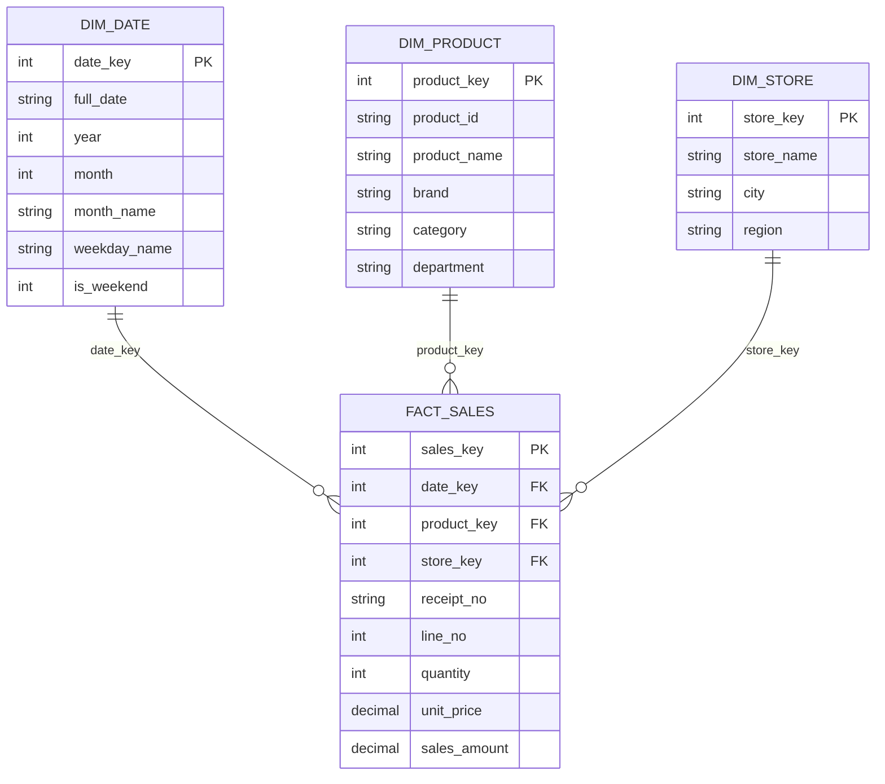
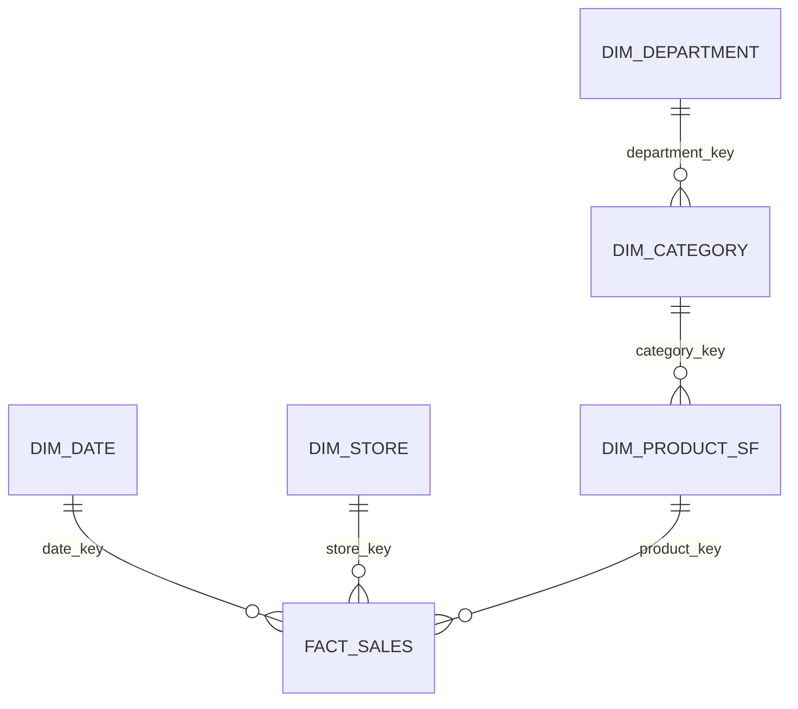
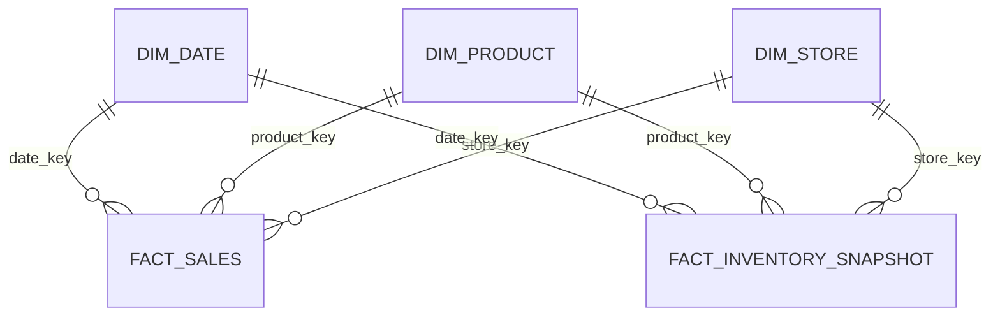

# Dátový sklad a dimenzionálne modelovanie: podrobný študijný materiál

Tento materiál prechádza pojmy zo zadania jeden po druhom a do hĺbky:

1. dátový sklad,
2. dimenzionálne modelovanie,
3. STAR schéma,
4. varianty: snehová vločka a súhvezdie,
5. metodológia tvorby dimenzionálnych modelov.

**Dôležité upozornenia**

- Ukážkový príklad (maloobchodný predaj) je zámerne generický. Slúži na vysvetlenie pojmov, nie ako model na odovzdanie. Váš vlastný príklad si navrhnete sami.
- Materiál je študijná pomôcka. Do protokolu patria presné zdroje (kniha, vydanie, ISBN a **čísla strán**), ktoré si musíte dohľadať priamo v literatúre. Strany tu zámerne neuvádzam.
- Tvrdenia v texte si overte v zdrojoch (zoznam je na konci). Termíny uvádzam po slovensky aj anglicky, lebo zdroje sú anglické.

## Obsah

1. [Dátový sklad](#1-dátový-sklad)
2. [Dimenzionálne modelovanie](#2-dimenzionálne-modelovanie)
3. [STAR schéma](#3-star-schéma)
4. [Snehová vločka](#4-snehová-vločka-snowflake)
5. [Súhvezdie](#5-súhvezdie-fact-constellation)
6. [Metodológia tvorby dimenzionálnych modelov](#6-metodológia-tvorby-dimenzionálnych-modelov)
7. [Časté chyby](#7-časté-chyby)
8. [Slovníček](#8-slovníček)
9. [Otázky na samoštúdium](#9-otázky-na-samoštúdium)
10. [Zdroje](#10-zdroje)

---

## 1. Dátový sklad

### 1.1 Prečo vôbec existuje

Firma má zvyčajne veľa prevádzkových systémov (objednávky, sklad, účtovníctvo, CRM). Každý z nich je navrhnutý tak, aby rýchlo zvládal bežnú prácu: pridať objednávku, zmeniť adresu zákazníka. Ak sa niekto spýta „aké boli tržby podľa regiónu a produktovej kategórie za posledné tri roky“, odpoveď je roztrúsená v niekoľkých systémoch a dotaz by ich spomalil. **Dátový sklad (data warehouse, DW)** zbiera dáta z týchto systémov na jedno miesto, upraví ich do jednotného tvaru a uchováva históriu, aby sa na nich dali robiť analýzy.

### 1.2 OLTP a OLAP

| Vlastnosť | OLTP (prevádzkový systém) | OLAP (dátový sklad) |
|---|---|---|
| Účel | každodenná prevádzka | analýza a rozhodovanie |
| Typický dotaz | „vlož objednávku“, „nájdi zákazníka 4711“ | „tržby podľa mesiaca a regiónu za 3 roky“ |
| Objem na dotaz | niekoľko riadkov | milióny riadkov |
| Operácie | veľa malých zápisov a čítaní | hlavne čítanie, veľké agregácie |
| Dáta | aktuálny stav | história |
| Návrh | normalizovaný (3NF), bez redundancie | často denormalizovaný (dimenzionálny model) |
| Používatelia | zamestnanci, aplikácie | analytici, manažment, BI nástroje |

Prečo sa to nerobí priamo v prevádzkovej databáze: dlhé analytické dotazy blokujú prevádzku, systémy majú rôzne formáty a chýba v nich história (stará hodnota sa prepíše).

### 1.3 Klasická definícia (Inmon)

Bill Inmon definuje dátový sklad ako súbor dát, ktorý je:

1. **Predmetovo orientovaný (subject-oriented).** Dáta sa organizujú podľa tém, ktoré zaujímajú firmu (zákazník, produkt, predaj), nie podľa aplikácií, z ktorých pochádzajú.
2. **Integrovaný (integrated).** Dáta z rôznych zdrojov sa zjednotia: rovnaké názvy, jednotky, kódovanie. Napríklad pohlavie môže byť v jednom systéme `M/F` a v druhom `1/2`, v sklade bude jeden tvar.
3. **Časovo variantný (time-variant).** Sklad uchováva históriu. Každý záznam je viazaný na čas, takže sa dá porovnať stav pred rokom a dnes.
4. **Nemenný (non-volatile).** Dáta sa do skladu zvyčajne pridávajú, nie prepisujú ani nemažú. Prevádzkový systém zmení adresu zákazníka prepísaním, sklad si zachová históriu zmien.

### 1.4 Typická architektúra a tok dát

```
Zdroje  ->  Staging  ->  Dátový sklad  ->  Data marty  ->  BI / reporty / dotazy
(ERP, CRM,  (surové      (integrované,     (pohľady pre     (dashboardy,
 súbory)     kópie)       historizované)    jednotlivé       SQL, analýzy)
                                            oddelenia)
```

- **Zdroje (source systems):** prevádzkové databázy, súbory, API.
- **Staging area:** dočasné miesto, kam sa dáta skopírujú v surovom tvare. Tu sa nič neanalyzuje, slúži ako medzistupeň.
- **ETL (Extract, Transform, Load):** extrakcia zo zdrojov, transformácia (čistenie, zjednotenie, prepočty, priradenie kľúčov) a načítanie do skladu. Variant **ELT** dáta najprv načíta a transformuje až v cieľovej databáze.
- **Dátový sklad:** cieľové úložisko. V dimenzionálnom prístupe tu žijú tabuľky faktov a dimenzií.
- **Metadáta:** údaje o údajoch (čo ktorý stĺpec znamená, odkiaľ pochádza, kedy sa načítal).
- **BI vrstva:** nástroje, ktoré dáta zobrazujú alebo analyzujú.

### 1.5 Data mart

**Data mart** je menšia, tematicky zameraná časť skladu (napr. predaj, financie), určená konkrétnemu oddeleniu. Môže vzniknúť odvodením z veľkého skladu alebo ho možno stavať ako samostatný mart a postupne ich zjednocovať.

### 1.6 Dva prístupy: Inmon a Kimball

| | Inmon (top-down) | Kimball (bottom-up) |
|---|---|---|
| Najprv | centrálny podnikový sklad (enterprise data warehouse) | jednotlivé dimenzionálne data marty |
| Model | normalizovaný (3NF) | dimenzionálny (fakty a dimenzie) |
| Data marty | vznikajú odvodením zo skladu | sú samotným skladom, spájajú ich spoločné dimenzie |
| Dôraz | integrácia dát v celej firme | rýchle výsledky pre analytikov |

V praxi sa často kombinujú. Zadanie sa sústreďuje na **dimenzionálny prístup (Kimball)**.

### 1.7 Čo si z kapitoly zapamätať

- Sklad slúži na analýzu, nie na prevádzku.
- Štyri vlastnosti podľa Inmona: predmetovo orientovaný, integrovaný, časovo variantný, nemenný.
- Dáta idú zo zdrojov cez ETL do skladu a odtiaľ do BI.

---

## 2. Dimenzionálne modelovanie

### 2.1 Základná myšlienka

Dimenzionálne modelovanie je technika návrhu databázy pre analytické dotazy. Cieľ nie je zabrániť duplicite (ako pri normalizácii), ale aby model bol:

- **zrozumiteľný** pre používateľa (ľahko sa v ňom orientuje),
- **rýchly** pri čítaní (málo joinov),
- **rozšíriteľný** (nové atribúty a fakty nerozbijú existujúce dotazy).

Model sa skladá z dvoch druhov tabuliek: **tabuľka faktov** (čo sa stalo, v číslach) a **dimenzie** (v akom kontexte sa to stalo).

Analytická otázka má vždy tvar: „**miera** podľa **dimenzie**“. Napríklad „tržby (miera) podľa mesiaca a kategórie produktu (dimenzie)“.

### 2.2 Tabuľka faktov (fact table)

Tabuľka faktov zaznamenáva **merateľné udalosti** obchodného procesu (predaj, objednávka, návšteva, platba).

#### Zrno (grain)

**Zrno** hovorí, čo presne znamená **jeden riadok** tabuľky faktov. Je to najdôležitejšie rozhodnutie v celom návrhu.

Príklady zrna pre predaj:
- „jedna položka na bločku“ (najjemnejšie),
- „jeden bloček“,
- „súhrn predaja produktu v predajni za deň“ (agregované).

Pravidlá:
- Zrno sa určí **pred** výberom dimenzií a mier.
- Každá dimenzia a každá miera musí byť jednoznačná **na úrovni zrna** (jeden riadok faktov má pre každú dimenziu práve jednu hodnotu).
- V jednej tabuľke faktov sa **nemiešajú rôzne zrná**.
- Odporúča sa začať s **najjemnejším (atomickým)** zrnom, lebo z neho sa dá agregovať hore, ale z agregátu sa späť nedá.

Ako to overiť: vedeli by ste vo vete dokončiť „jeden riadok faktov predstavuje ...“? Ak nie, zrno nie je určené.

#### Miery (measures)

Miery sú číselné hodnoty, ktoré sa analyzujú (suma, množstvo, cena, trvanie). Delia sa podľa toho, či sa dajú sčítať:

| Typ | Význam | Príklad |
|---|---|---|
| **Aditívna** | dá sa sčítať cez všetky dimenzie | tržba, počet kusov |
| **Poloaditívna (semi-additive)** | dá sa sčítať cez niektoré dimenzie, ale nie cez čas | stav na sklade, zostatok na účte |
| **Neaditívna (non-additive)** | sčítať sa nedá | percento zľavy, jednotková cena |

Neaditívne miery sa zvyčajne ukladajú ako ich zložky (čitateľ a menovateľ) a pomer sa počíta až pri dotaze (napr. `SUM(zľava) / SUM(tržba)`, nie `AVG` zo zlomkov).

#### Cudzie kľúče a degenerované dimenzie

- Tabuľka faktov obsahuje **cudzí kľúč na každú dimenziu**.
- Primárny kľúč býva buď zložený z kľúčov dimenzií (ak zrno zaručuje jedinečnosť), alebo samostatný umelý kľúč.
- **Degenerovaná dimenzia (degenerate dimension)** je identifikátor, ktorý nemá vlastnú dimenzionálnu tabuľku, lebo by nemala žiadne ďalšie atribúty. Typicky číslo bločku alebo faktúry, ktoré zostáva priamo v tabuľke faktov a slúži na zoskupenie riadkov jednej transakcie.

#### Typy tabuliek faktov

| Typ | Jeden riadok je | Príklad | Poznámka |
|---|---|---|---|
| **Transakčná (transaction)** | jedna udalosť v čase | položka na bločku | najčastejšia, najjemnejšie zrno |
| **Periodický snímok (periodic snapshot)** | stav na konci periódy | stav zásob na konci dňa | pravidelne sa zapisuje aj bez udalosti |
| **Akumulujúci snímok (accumulating snapshot)** | celý životný cyklus procesu | objednávka od prijatia po doručenie | riadok sa **aktualizuje**, kým proces beží (viac dátumových stĺpcov) |
| **Faktová tabuľka bez mier (factless)** | výskyt udalosti alebo pokrytie | účasť študenta na prednáške | nemá numerické miery, analyzuje sa počítaním riadkov |

#### Ďalšie vlastnosti

- Tabuľky faktov bývajú **vysoké a úzke** (veľa riadkov, málo stĺpcov) a zaberajú väčšinu miesta v sklade.
- Do cudzieho kľúča sa **nedáva NULL**. Ak hodnota chýba alebo nie je známa, použije sa špeciálny riadok dimenzie („Neznámy“, „Nehodí sa“).

### 2.3 Dimenzie (dimension tables)

Dimenzie opisujú **kontext** faktu: **kto, čo, kde, kedy, prečo, ako**. Sú to „podstatné mená“ analýzy a podľa ich atribútov sa dotazy filtrujú, zoskupujú a označujú.

#### Vlastnosti dimenzií

- **Široké a krátke:** veľa stĺpcov (atribútov), relatívne málo riadkov oproti faktom.
- **Atribúty sú prevažne textové,** ľudsky čitateľné (názov mesiaca, nie číslo; názov kategórie, nie kód). Dobré atribúty sú to, čo používateľ v dotaze použije v `WHERE` a `GROUP BY`.
- **Denormalizované:** celá hierarchia (produkt, značka, kategória, oddelenie) je v jednej tabuľke. Hodnoty sa opakujú, ale dotaz je jednoduchý.
- **Hierarchie:** atribúty môžu tvoriť hierarchiu (deň, mesiac, štvrťrok, rok). Táto hierarchia umožňuje **drill-down** (od roka k mesiacom) a **roll-up** (opačne).

#### Umelý kľúč (surrogate key)

Každá dimenzia má vlastný celočíselný kľúč **bez významu**, ktorý generuje sklad. Pôvodný kľúč zo zdroja (napr. kód produktu) sa uloží ako obyčajný atribút a volá sa **prirodzený (natural) alebo obchodný (business) kľúč**.

Prečo umelý kľúč:
- zdroj môže kľúč zmeniť alebo recyklovať,
- dáta z viacerých zdrojov môžu mať kolidujúce kľúče,
- umožňuje uchovať **viac verzií** toho istého objektu (história, pozri SCD),
- dá sa pomocou neho vyjadriť „neznámy“ alebo „nehodí sa“.

#### Dimenzia dátumu

Je v takmer každom modeli. Vopred sa vyplní na roky dopredu a obsahuje atribúty, ktoré SQL len ťažko odvodí: názov dňa, týždeň, mesiac, štvrťrok, rok, príznak víkendu, sviatok, fiškálne obdobie. Je to jediná dimenzia, kde sa bežne používa kľúč s významom (formát `YYYYMMDD`, napr. `20261003`).

#### Špeciálne druhy dimenzií

| Druh | Čo je |
|---|---|
| **Konformná (conformed)** | dimenzia používaná vo viacerých tabuľkách faktov s rovnakým významom a kľúčmi (základ súhvezdia) |
| **Rolová (role-playing)** | jedna fyzická dimenzia použitá viackrát s inou rolou (napr. dátum objednávky a dátum doručenia) |
| **Degenerovaná (degenerate)** | identifikátor priamo vo faktoch bez vlastnej tabuľky |
| **Junk dimenzia** | spojenie niekoľkých malých príznakov a kódov (napr. spôsob platby, príznak darčekového balenia) do jednej dimenzie |
| **Mini-dimenzia** | oddelená dimenzia pre často sa meniace atribúty veľkej dimenzie |
| **Outrigger** | dimenzia pripojená k inej dimenzii (porušuje čistú hviezdu, pozri snehová vločka) |

### 2.4 Pomaly sa meniace dimenzie (SCD, Slowly Changing Dimensions)

Atribúty dimenzií sa v čase menia (zákazník sa presťahuje, produkt zmení kategóriu). Existuje niekoľko stratégií:

| Typ | Čo robí | História | Použitie |
|---|---|---|---|
| **Typ 0** | hodnota sa nikdy nemení | pôvodná | napr. dátum prvého nákupu |
| **Typ 1** | stará hodnota sa **prepíše** | žiadna | oprava preklepu, história nie je potrebná |
| **Typ 2** | pridá sa **nový riadok** s novým umelým kľúčom | úplná | najčastejšie, keď treba históriu |
| **Typ 3** | pridá sa stĺpec so starou hodnotou (napr. `predosla_kategoria`) | iba jedna predošlá | keď stačí „predtým a teraz“ |

Pri **type 2** sa k riadku pridajú stĺpce `valid_from`, `valid_to` a `is_current`. Fakt vždy odkazuje na verziu dimenzie platnú v čase udalosti, takže staré predaje zostanú pripísané starej adrese a nové novej.

```sql
-- runnable
CREATE TABLE dim_customer (
    customer_key  INTEGER PRIMARY KEY,   -- umelý kľúč (každá verzia má vlastný)
    customer_id   TEXT    NOT NULL,      -- obchodný kľúč zo zdroja (rovnaký pre obe verzie)
    customer_name TEXT    NOT NULL,
    city          TEXT    NOT NULL,
    valid_from    TEXT    NOT NULL,
    valid_to      TEXT    NOT NULL,
    is_current    INTEGER NOT NULL
);
INSERT INTO dim_customer VALUES
 (1, 'C-100', 'Jana Nováková', 'Košice',     '2024-01-01', '2026-05-31', 0),
 (2, 'C-100', 'Jana Nováková', 'Bratislava', '2026-06-01', '9999-12-31', 1);
```

Zákazníčka C-100 má dva riadky. Nákupy z roku 2025 budú odkazovať na `customer_key = 1` (Košice), nákupy po 1. 6. 2026 na `customer_key = 2` (Bratislava). Pri type 1 by existoval jediný riadok a všetky nákupy by sa spätne pripísali Bratislave.

### 2.5 Vzťah faktov a dimenzií a notácia crow's foot

Medzi dimenziou a faktami platí vzťah **1 : N**: jeden riadok dimenzie sa vyskytuje v mnohých riadkoch faktov, ale každý riadok faktov patrí práve jednému riadku dimenzie.

**Crow's foot (vranie nohy)** znázorňuje násobnosť vzťahu na koncoch čiary:

| Symbol | Význam |
|---|---|
| `||` | presne jeden |
| `o|` | nula alebo jeden |
| `|{` | jeden alebo viac |
| `o{` | nula alebo viac |

Dimenzia a fakty: `DIM ||--o{ FACT` (dimenzia: presne jeden, fakty: nula alebo viac). V nástroji Mermaid sa tento zápis používa priamo.

---

## 3. STAR schéma

### 3.1 Štruktúra

**STAR (hviezdicová) schéma** je dimenzionálny model, v ktorom je v strede **jedna tabuľka faktov** a okolo nej **dimenzie**, každá pripojená jedným cudzím kľúčom. V diagrame to pripomína hviezdu.

Základné pravidlá:
- fakty obsahujú cudzie kľúče a miery,
- každá dimenzia je **jedna** tabuľka (denormalizovaná),
- dimenzie sa navzájom nespájajú, spájajú sa len cez fakty.

### 3.2 Diagram (crow's foot, Mermaid)



### 3.3 Ukážkový príklad (generický maloobchod)

**Obchodný proces:** predaj v predajniach.
**Zrno:** jedna položka (riadok) na bločku.
**Dimenzie:** dátum, produkt, predajňa.
**Miery:** množstvo, jednotková cena, suma predaja. Číslo bločku je degenerovaná dimenzia.

```sql
-- runnable
PRAGMA foreign_keys = ON;

CREATE TABLE dim_date (
    date_key     INTEGER PRIMARY KEY,
    full_date    TEXT    NOT NULL,
    year         INTEGER NOT NULL,
    month        INTEGER NOT NULL,
    month_name   TEXT    NOT NULL,
    weekday_name TEXT    NOT NULL,
    is_weekend   INTEGER NOT NULL
);
CREATE TABLE dim_product (
    product_key  INTEGER PRIMARY KEY,
    product_id   TEXT NOT NULL,
    product_name TEXT NOT NULL,
    brand        TEXT NOT NULL,
    category     TEXT NOT NULL,
    department   TEXT NOT NULL
);
CREATE TABLE dim_store (
    store_key  INTEGER PRIMARY KEY,
    store_name TEXT NOT NULL,
    city       TEXT NOT NULL,
    region     TEXT NOT NULL
);
CREATE TABLE fact_sales (
    sales_key    INTEGER PRIMARY KEY,
    date_key     INTEGER NOT NULL REFERENCES dim_date(date_key),
    product_key  INTEGER NOT NULL REFERENCES dim_product(product_key),
    store_key    INTEGER NOT NULL REFERENCES dim_store(store_key),
    receipt_no   TEXT    NOT NULL,
    line_no      INTEGER NOT NULL,
    quantity     INTEGER NOT NULL,
    unit_price   REAL    NOT NULL,
    sales_amount REAL    NOT NULL
);

INSERT INTO dim_date VALUES
 (20261001, '2026-10-01', 2026, 10, 'október', 'štvrtok', 0),
 (20261002, '2026-10-02', 2026, 10, 'október', 'piatok',  0),
 (20261003, '2026-10-03', 2026, 10, 'október', 'sobota',  1);
INSERT INTO dim_product VALUES
 (1, 'P-001', 'Mlieko 1 l',  'Mliečko', 'Mliečne výrobky', 'Potraviny'),
 (2, 'P-002', 'Chlieb 500 g','Pekáreň', 'Pečivo',          'Potraviny'),
 (3, 'P-003', 'USB kábel',   'TechPro', 'Elektronika',     'Technika');
INSERT INTO dim_store VALUES
 (1, 'Centrum',  'Košice',     'Východ'),
 (2, 'Eurovea',  'Bratislava', 'Západ');
INSERT INTO fact_sales VALUES
 (1, 20261001, 1, 1, 'R1001', 1, 2, 0.99,  1.98),
 (2, 20261001, 2, 1, 'R1001', 2, 1, 1.49,  1.49),
 (3, 20261001, 3, 1, 'R1002', 1, 1, 7.90,  7.90),
 (4, 20261002, 1, 2, 'R2001', 1, 3, 0.99,  2.97),
 (5, 20261002, 3, 2, 'R2001', 2, 2, 7.90, 15.80),
 (6, 20261003, 2, 1, 'R2002', 1, 4, 1.49,  5.96);
```

**Ako čítať riadok faktov.** Riadok `(4, 20261002, 1, 2, 'R2001', 1, 3, 0.99, 2.97)` znamená: 2. 10. 2026 (dimenzia dátumu) sa v predajni Eurovea (dimenzia predajne) predali 3 kusy mlieka (dimenzia produktu) za 0,99 €, spolu 2,97 €, na prvom riadku bločku R2001.

### 3.4 Základný analytický dotaz

Dotaz na STAR schéme má vždy rovnaký vzor:

1. `FROM` tabuľka faktov,
2. `JOIN` len tie dimenzie, ktoré potrebujem,
3. `WHERE` filtruje podľa atribútov dimenzií,
4. `GROUP BY` zoskupuje podľa atribútov dimenzií,
5. agregačná funkcia (`SUM`, `AVG`, `COUNT`) sa aplikuje na miery.

```sql
-- runnable
SELECT d.month_name,
       p.category,
       SUM(f.quantity)                AS pocet_kusov,
       ROUND(SUM(f.sales_amount), 2)  AS trzby
FROM fact_sales f
JOIN dim_date    d ON d.date_key    = f.date_key
JOIN dim_product p ON p.product_key = f.product_key
GROUP BY d.month_name, p.category
ORDER BY trzby DESC;
```

Výsledok pre ukážkové dáta:

| month_name | category | pocet_kusov | trzby |
|---|---|---|---|
| október | Elektronika | 3 | 23.70 |
| október | Pečivo | 5 | 7.45 |
| október | Mliečne výrobky | 5 | 4.95 |

Dotaz „čo by sa zmenilo, keby som chcel tržby podľa mesta predajne“: namiesto dimenzie produktu pripojím `dim_store` a zoskupím podľa `s.city`. Fakty sa nemenia, mení sa len pripojená dimenzia, v tom je sila modelu.

### 3.5 Prečo je STAR schéma praktická

**Výhody:**
- jednoduché a predvídateľné dotazy (málo joinov, každá dimenzia sa pripája jedným kľúčom),
- zrozumiteľná pre používateľov a BI nástroje,
- dobrý výkon pri čítaní,
- ľahko sa rozširuje (nová dimenzia je nový stĺpec s cudzím kľúčom, nový atribút je nový stĺpec v dimenzii).

**Nevýhody:**
- redundancia v dimenziách (text sa opakuje),
- zložitejšia aktualizácia (zmena názvu kategórie sa týka viacerých riadkov),
- dimenzie môžu byť široké.

### 3.6 Modifikácie STAR schémy

Základnú hviezdu možno upraviť, napríklad:
- **snehová vločka** (kapitola 4),
- **súhvezdie** (kapitola 5),
- **rolová dimenzia** (dátum objednávky a dátum doručenia z jednej `dim_date`),
- **junk dimenzia** (zlúčenie príznakov),
- **faktová tabuľka bez mier**,
- **SCD typ 2** pre históriu atribútov,
- **degenerovaná dimenzia** (číslo bločku vo faktoch).

---

## 4. Snehová vločka (snowflake)

### 4.1 Čo to je

**Snehová vločka** je variant, v ktorom sú **dimenzie normalizované** do viacerých prepojených tabuliek. Namiesto jednej tabuľky `dim_product` s kategóriou a oddelením vznikne reťaz `produkt → kategória → oddelenie`. V diagrame sa dimenzia „rozvetví“ ako vločka.

### 4.2 Diagram



### 4.3 Príklad

```sql
-- runnable
CREATE TABLE dim_department (
    department_key  INTEGER PRIMARY KEY,
    department_name TEXT NOT NULL
);
CREATE TABLE dim_category (
    category_key   INTEGER PRIMARY KEY,
    category_name  TEXT NOT NULL,
    department_key INTEGER NOT NULL REFERENCES dim_department(department_key)
);
CREATE TABLE dim_product_sf (
    product_key  INTEGER PRIMARY KEY,
    product_id   TEXT NOT NULL,
    product_name TEXT NOT NULL,
    brand        TEXT NOT NULL,
    category_key INTEGER NOT NULL REFERENCES dim_category(category_key)
);
INSERT INTO dim_department VALUES (1, 'Potraviny'), (2, 'Technika');
INSERT INTO dim_category VALUES (1, 'Mliečne výrobky', 1), (2, 'Pečivo', 1), (3, 'Elektronika', 2);
INSERT INTO dim_product_sf VALUES
 (1, 'P-001', 'Mlieko 1 l',   'Mliečko', 1),
 (2, 'P-002', 'Chlieb 500 g', 'Pekáreň', 2),
 (3, 'P-003', 'USB kábel',    'TechPro', 3);
```

Dotaz „tržby podľa oddelenia“ potrebuje o dva joiny viac než v STAR schéme:

```sql
-- runnable
SELECT dep.department_name,
       ROUND(SUM(f.sales_amount), 2) AS trzby
FROM fact_sales f
JOIN dim_product_sf p    ON p.product_key      = f.product_key
JOIN dim_category   c    ON c.category_key     = p.category_key
JOIN dim_department dep  ON dep.department_key = c.department_key
GROUP BY dep.department_name
ORDER BY trzby DESC;
```

Výsledok: Technika 23.70, Potraviny 12.40. Zhodné výsledky so STAR schémou, rozdiel je len v počte joinov.

### 4.4 Porovnanie so STAR

| | STAR | Snehová vločka |
|---|---|---|
| Dimenzie | denormalizované (jedna tabuľka) | normalizované (viac tabuliek) |
| Počet joinov v dotaze | menej | viac |
| Redundancia | vyššia | nižšia |
| Miesto na disku (dimenzie) | o niečo viac | o niečo menej |
| Zložitosť dotazov | nižšia | vyššia |
| Zrozumiteľnosť pre používateľa | vyššia | nižšia |

### 4.5 Kedy sa použije

- veľmi veľká dimenzia, kde normalizácia reálne ušetrí miesto,
- hierarchia, ktorú používa viac dimenzií spoločne (napr. geografia, ktorú zdieľa dimenzia zákazníka aj predajne),
- požiadavka na centrálnu správu údajov (zmena názvu kategórie na jednom mieste).

Odporúčanie literatúry (Kimball): **uprednostňovať STAR schému** a snehovú vločku použiť len keď je na to dôvod. Rozdiel v ušetrenom mieste je pri dimenziách malý, lebo dimenzie sú oproti faktom krátke.

---

## 5. Súhvezdie (fact constellation)

### 5.1 Čo to je

**Súhvezdie** (označuje sa aj galaxy schema) je model s **viacerými tabuľkami faktov, ktoré zdieľajú spoločné dimenzie**. Každá tabuľka faktov zodpovedá jednému obchodnému procesu (predaj, zásoby, vrátenia). V diagrame viac hviezd zdieľa niektoré „cípy“.

### 5.2 Diagram



### 5.3 Príklad

K predaju pridáme druhý proces: **zásoby**. Zrno: stav produktu v predajni na konci dňa (periodický snímok). Miera `quantity_on_hand` je poloaditívna: cez predajne a produkty sa sčítať dá, cez čas nie (súčet stavov za 7 dní nie je zásoba).

```sql
-- runnable
CREATE TABLE fact_inventory_snapshot (
    date_key         INTEGER NOT NULL REFERENCES dim_date(date_key),
    store_key        INTEGER NOT NULL REFERENCES dim_store(store_key),
    product_key      INTEGER NOT NULL REFERENCES dim_product(product_key),
    quantity_on_hand INTEGER NOT NULL,
    PRIMARY KEY (date_key, store_key, product_key)
);
INSERT INTO fact_inventory_snapshot (date_key, store_key, product_key, quantity_on_hand)
SELECT d.date_key, s.store_key, p.product_key, 50 - p.product_key * 5
FROM dim_date d CROSS JOIN dim_store s CROSS JOIN dim_product p
WHERE d.date_key IN (20261001, 20261002);
```

Obe tabuľky faktov používajú **tie isté dimenzie** `dim_date`, `dim_store` a `dim_product`. Tie sa nazývajú **konformné dimenzie (conformed dimensions)**.

### 5.4 Konformné dimenzie a drill-across

Konformná dimenzia je taká, ktorá má vo všetkých faktoch rovnaký význam, rovnaké kľúče a rovnaké názvy atribútov (alebo je jednou z druhej podmnožinou). Vďaka tomu možno porovnávať dva procesy.

**Drill-across** je dotaz, ktorý spája výsledky z **viacerých tabuliek faktov**. Postup:

1. z každej tabuľky faktov samostatne agregovať na úroveň spoločných atribútov dimenzií,
2. výsledky spojiť podľa týchto atribútov.

Fakty sa **nesmú spájať priamo** medzi sebou (join dvoch tabuliek faktov by násobil riadky a skreslil súčty).

```sql
-- runnable
SELECT d.full_date,
       s.city,
       p.product_name,
       i.quantity_on_hand,
       COALESCE(x.sold_qty, 0) AS sold_qty
FROM fact_inventory_snapshot i
JOIN dim_date    d ON d.date_key    = i.date_key
JOIN dim_store   s ON s.store_key   = i.store_key
JOIN dim_product p ON p.product_key = i.product_key
LEFT JOIN (
    SELECT date_key, store_key, product_key, SUM(quantity) AS sold_qty
    FROM fact_sales
    GROUP BY date_key, store_key, product_key
) x ON x.date_key = i.date_key AND x.store_key = i.store_key AND x.product_key = i.product_key
ORDER BY d.full_date, s.city, p.product_name;
```

Predaje sa najprv zosumujú na úroveň (dátum, predajňa, produkt), a až potom sa pripoja k zásobám. `LEFT JOIN` je dôležitý: ak by sa daný produkt v ten deň nepredal, riadok zásob by pri `INNER JOIN` zmizol, kým takto má `sold_qty = 0`.

### 5.5 Bus matica (enterprise data warehouse bus matrix)

Plán súhvezdia sa zachytáva v **bus matici**: riadky sú obchodné procesy (tabuľky faktov), stĺpce sú konformné dimenzie, a v bunke je značka, ak proces danú dimenziu používa.

| Proces (fakty) | Dátum | Produkt | Predajňa | Zákazník |
|---|:-:|:-:|:-:|:-:|
| Predaj | X | X | X | X |
| Zásoby | X | X | X | |
| Vrátenia | X | X | X | X |

Matica ukazuje, ktoré dimenzie sa zdieľajú, a teda ktoré procesy sa dajú navzájom porovnávať.

---

## 6. Metodológia tvorby dimenzionálnych modelov

Najpoužívanejší postup pochádza od Ralpha Kimballa.

### 6.1 Príprava: požiadavky

Pred modelovaním treba zistiť, **aké otázky má sklad zodpovedať**. Dôležité je hovoriť s používateľmi (analytici, manažéri) a pozrieť si dostupné zdrojové dáta. Model sa neodvodzuje len zo zdrojovej databázy, ale z potrieb analýzy. Výsledkom sú zoznam otázok a zoznam obchodných procesov.

### 6.2 Štyri kroky dimenzionálneho návrhu

Poradie je záväzné, lebo každý krok stavia na predošlom.

**Krok 1: Vyber obchodný proces (select the business process).**
Proces je činnosť organizácie, ktorá generuje merateľné dáta (predaj, objednávka, výplata, rezervácia). Dotaz si pri tom položte: *Čo chceme analyzovať?* Jeden proces zvyčajne zodpovedá jednej tabuľke faktov.

**Krok 2: Deklaruj zrno (declare the grain).**
Rozhodnite, čo znamená jeden riadok tabuľky faktov. Formulujte to vetou: „Jeden riadok faktov predstavuje ...“. Zrno musí byť určené skôr, než sa vyberú dimenzie a miery.

**Krok 3: Identifikuj dimenzie (identify the dimensions).**
Pre každú dimenziu sa spýtajte: *Ako opisujú používatelia dáta tohto procesu? Podľa čoho chcú filtrovať a zoskupovať?* Každá dimenzia musí byť pri zvolenom zrne jednoznačná (jeden riadok faktov = jedna hodnota dimenzie). Dobrý test: pre dimenziu napíšte aspoň 4 – 5 zmysluplných textových atribútov.

**Krok 4: Identifikuj fakty (identify the facts).**
Určte miery, ktoré sa budú analyzovať. Každá miera musí zodpovedať zrnu. Pri každej určte, či je aditívna, poloaditívna alebo neaditívna.

### 6.3 Ďalšie činnosti okolo návrhu

| Činnosť | Zmysel |
|---|---|
| Bus matica | plán viacerých procesov a spoločných (konformných) dimenzií |
| Návrh atribútov dimenzií | názvy a hodnoty zrozumiteľné pre používateľa |
| Stratégia SCD | rozhodnúť pre každý atribút typ 1, 2 alebo 3 |
| Fyzický návrh | typy stĺpcov, kľúče, indexy |
| Návrh ETL | ako dáta dostať zo zdrojov do modelu (umelé kľúče, riadky „neznámy“) |
| Testovanie | vzorové dotazy a kontrola, že odpovedajú na pôvodné otázky |

V Kimballovom životnom cykle (lifecycle) sa po plánovaní a zbere požiadaviek vetví práca do troch stôp: technológie, dáta (modelovanie, fyzický návrh, ETL) a BI aplikácie, nasleduje nasadenie, údržba a rozvoj.

### 6.4 Kontrolný zoznam hotového modelu

- [ ] Je zrno deklarované jednou vetou?
- [ ] Obsahuje tabuľka faktov len miery zodpovedajúce zrnu?
- [ ] Má každá dimenzia umelý kľúč a prirodzený kľúč ako atribút?
- [ ] Majú dimenzie dostatok textových atribútov (nie len kódy)?
- [ ] Je k dispozícii dimenzia dátumu?
- [ ] Je ošetrené chýbajúce alebo neznáme (riadok „Neznámy“ namiesto NULL)?
- [ ] Je rozhodnuté, ktoré atribúty potrebujú históriu (SCD)?
- [ ] Dá sa na modeli napísať aspoň jeden zmysluplný dotaz podľa každej pôvodnej otázky?

### 6.5 Postup na tutoriál (mapa pre vás)

1. Určte jednoduchý obchodný proces, ktorý viete vysvetliť.
2. Sformulujte 2 – 3 otázky, ktoré má sklad zodpovedať.
3. Deklarujte zrno jednou vetou.
4. Navrhnite aspoň tri dimenzie a pri každej aspoň 4 atribúty.
5. Určte miery a ich typ (aditívna, poloaditívna, neaditívna).
6. Nakreslite diagram v crow's foot a pripravte vzorové riadky.
7. Napíšte SQLite skript a otestujte dotazy.
8. Pripravte modifikácie (snehová vločka, súhvezdie, SCD) a vedzte vysvetliť, prečo ste nezvolili ich.

---

## 7. Časté chyby

| Chyba | Prečo je to problém |
|---|---|
| Nedeklarované alebo zmiešané zrno | súčty sa budú duplikovať alebo budú zavádzajúce |
| Textové atribúty vo faktoch | patria do dimenzií, fakty majú byť úzke |
| Dimenzia len s kódmi, bez popisov | používateľ nevie čítať výstup |
| Chýba dimenzia dátumu | veľa výpočtov sa musí robiť ručne v každom dotaze |
| Pomalá zmena atribútu bez stratégie | história sa stratí alebo skreslí |
| NULL v cudzom kľúči faktov | riadky vypadnú pri joine, použite riadok „Neznámy“ |
| Zbytočná snehová vločka | viac joinov bez reálneho prínosu |
| Sčítanie neaditívnej miery | nezmyselný výsledok (napr. súčet percent) |
| Join dvoch tabuliek faktov priamo | násobenie riadkov, treba drill-across |
| Dizajn len podľa zdrojovej databázy | model nezodpovie obchodné otázky |

---

## 8. Slovníček

| Slovensky | Anglicky | Stručne |
|---|---|---|
| dátový sklad | data warehouse (DW) | databáza na analýzu, integrovaná a historizovaná |
| prevádzkový systém | OLTP | systém na bežnú prácu s transakciami |
| analytické spracovanie | OLAP | analýza veľkých objemov dát |
| ETL | Extract, Transform, Load | prenos dát zo zdrojov do skladu |
| data mart | data mart | tematická časť skladu |
| tabuľka faktov | fact table | merateľné udalosti procesu |
| dimenzia | dimension | kontext faktov |
| zrno | grain | čo znamená jeden riadok faktov |
| miera | measure | číselná hodnota vo faktoch |
| aditívna miera | additive measure | dá sa sčítať cez všetky dimenzie |
| umelý kľúč | surrogate key | kľúč bez významu generovaný skladom |
| prirodzený kľúč | natural / business key | identifikátor zo zdroja |
| degenerovaná dimenzia | degenerate dimension | identifikátor vo faktoch bez vlastnej tabuľky |
| STAR schéma | star schema | fakty v strede, denormalizované dimenzie okolo |
| snehová vločka | snowflake schema | normalizované dimenzie |
| súhvezdie | fact constellation / galaxy | viac faktov so spoločnými dimenziami |
| konformná dimenzia | conformed dimension | dimenzia zdieľaná medzi faktmi |
| rolová dimenzia | role-playing dimension | jedna dimenzia použitá vo viacerých rolách |
| pomaly sa meniaca dimenzia | slowly changing dimension (SCD) | spôsoby uchovania zmien atribútov |
| bus matica | bus matrix | plán procesov a spoločných dimenzií |
| drill-down / roll-up | drill-down / roll-up | zjemnenie / zhrubnenie úrovne analýzy |
| drill-across | drill-across | porovnanie viacerých tabuliek faktov |

---

## 9. Otázky na samoštúdium

Skúste odpovedať bez pozerania do textu. Takéto otázky môžu padnúť počas tutoriálu.

1. Čím sa líši OLTP systém od dátového skladu? Uveďte aspoň tri rozdiely.
2. Vymenujte štyri vlastnosti dátového skladu podľa Inmona a vysvetlite jednu z nich príkladom.
3. Čo je zrno tabuľky faktov a prečo sa určuje ako prvé?
4. Aký je rozdiel medzi aditívnou, poloaditívnou a neaditívnou mierou? Dajte príklad každej.
5. Prečo má dimenzia umelý kľúč, keď už má kľúč zo zdroja?
6. Čo je degenerovaná dimenzia? Uveďte príklad.
7. Prečo sa do cudzieho kľúča faktov nedáva NULL?
8. Vysvetlite SCD typ 1, 2 a 3. Kedy by ste použili ktorý?
9. Prečo je dimenzia dátumu samostatná tabuľka a nie funkcia v SQL?
10. Čím sa líši STAR schéma od snehovej vločky? Aké sú výhody a nevýhody každej?
11. Kedy použijete súhvezdie? Čo sú konformné dimenzie?
12. Čo je drill-across a prečo sa tabuľky faktov nespájajú priamo?
13. Vymenujte štyri kroky Kimballovho návrhu v správnom poradí.
14. Čo je bus matica a čo z nej vyčítate?
15. Aký je rozdiel medzi Inmonovým a Kimballovým prístupom?

---

## 10. Zdroje

Základná literatúra na štúdium (údaje o vydaniach si overte priamo v knihe a doplňte čísla strán a kapitoly do protokolu):

- Kimball, R., Ross, M.: *The Data Warehouse Toolkit: The Definitive Guide to Dimensional Modeling*. 3. vydanie. Wiley. 2013. ISBN 978-1-118-53080-1. (Kapitola 1 a 2: základné pojmy, štvorkrokový návrh, techniky dimenzionálneho modelovania; ďalšie kapitoly obsahujú príklady a SCD.)
- Inmon, W. H.: *Building the Data Warehouse*. Wiley. (Definícia dátového skladu a normalizovaný prístup.) Presné vydanie, rok a ISBN si doplňte podľa exemplára, ktorý použijete.
- Dokumentácia SQLite: https://www.sqlite.org/docs.html (syntax SQL, príkaz `.read`).
- Dokumentácia Mermaid, diagramy entít a vzťahov (crow's foot): https://mermaid.js.org

Pri zápise do protokolu: pre webstránky uveďte URL a konkrétnu pasáž, pre knihy autora, názov, vydavateľstvo, rok, vydanie, ISBN a **presnú lokalizáciu vrátane čísla strany**. Konverzáciu s LLM zaznamenajte ako postupnosť promptov a odpovedí v tabuľke podľa šablóny a uveďte, ktorý model ste použili.